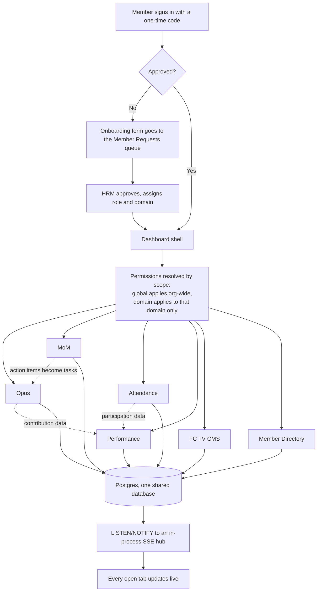

# FC OS: slide deck content

> One system for Founders Club. Every internal tool behind one login, one permission model, one dashboard.

---

## 1. Problem statement

- Club work lives in WhatsApp threads, spreadsheets and Drive folders. There is no one place that says what is true.
- Ownership is unclear. Tasks get mentioned in chat and then scroll away, and the things decided in a meeting are rarely tracked afterwards.
- Access is handled by hand. People who have left still hold edit rights, and new members wait to be let in.
- Every handover at the end of a tenure loses whatever the last team knew. The next one starts over.
- Paid tools like Notion, Jira and Asana charge per seat and assume a company, not a student club with no budget.

---

## 2. Background and needs

Founders Club runs four domains: technical, creatives, operations and outreach. Each one runs its own projects and events in parallel, and the club also runs meetings, events, C2C sessions and help desks that people are expected to show up to.

What the club needs and does not have:

- Work planned and tracked per domain, with a real owner and a real status.
- Meetings captured, so decisions and action items survive the meeting.
- Attendance and contribution recorded, so end-of-term reviews are based on something.
- A way to publish content to the club screens.
- People managed in one place: directory, onboarding, approvals, role changes.

Two constraints shaped everything. There is no recurring budget, and the campus network blocks the usual hosting and tunneling paths. So the system has to be self-hostable, cheap to run, and owned by the club.

---

## 3. Target users and audience

| User | What they need |
|---|---|
| Members | See my tasks, move them along, mark attendance, report bugs |
| Leads, co-leads, associate leads | Assign work and run their domain's board |
| President and VP | Cross-domain view, approvals, control over the permission grid |
| Human resource manager | Approve joiners, assign roles and domains |
| Advisors and alumni | Read-only visibility, with no write access at all |

Today the club is 22 people. Any student club with domains and a rotating committee has the same shape, so the model transfers.

---

## 4. Proposed solution

FC OS is one Next.js app: a single auth gate, a single permission engine, and tools behind it.

Running in production:

- Opus, the per-domain kanban workspace. Tasks, subtasks, assignees, labels, links, and statuses and priorities that the club defines itself.
- Member Directory, where approvers edit roles and domains and remove members.
- Member Requests, the two-stage onboarding and approval queue.
- Roles and Permissions, an editable grid that decides what every role can do.
- Bug Reports, so members can file problems with FC OS from inside FC OS.
- An app-wide theme selector with light and dark modes and eight palettes.

Built into the shell but not integrated yet. The routes and sidebar entries already exist, marked "Coming Soon":

- MoM, for minutes of meeting. Record a meeting, get decisions and action items out of it, and file those as Opus tasks.
- Attendance Tracker. The database side already exists: an `activity` table covering meetings, events, C2C and help desks, and an `attendance` table keyed to members. What is missing is the interface.
- Performance Tracker, scoring contribution per member and per domain from Opus and attendance data.
- FC TV CMS, for publishing to the club display screens.

All four reuse the same auth, permission model, realtime layer and component library, so the cost of adding them is mostly interface work. They are also worth more together than apart: a meeting turns into tasks, and tasks plus attendance turn into a performance record.

---

## 5. Workflow

One gate, one permission check, one database. The tools feed each other instead of sitting in separate silos.

---

## 6. Key features and innovation

**Permissions, not role names.** Authorization asks whether you hold a capability, never whether you are called "lead". Roles and permissions live in an editable grid, and scope does the narrowing: a grant held through a domain-scoped role applies only inside that member's domains, while a global-scoped role applies org-wide. That single rule is why a lead manages one board and the president manages all of them. Grants are additive with no deny rules, so read-only roles hold nothing at all.

**Realtime that costs almost nothing.** Postgres `LISTEN/NOTIFY` feeds one process-wide hub, which fans out over SSE to every open tab. We measured 200 concurrent authenticated connections held with no measurable memory growth, 0.0% CPU, and page response times unchanged. Firing one notify reached all 200 clients. There is no polling and no third-party realtime vendor.

**The club configures its own process.** Statuses, priorities, domains and permissions are rows in the database, not enums in the code. Renaming a status or changing who can approve members takes no deploy.

**Ours, end to end.** Our hardware, our database, our backups. No per-seat cost and nothing to migrate off later.

**The bet on agents.** We think the near future is agentic, and that before long every member will have their own agent running around the clock beside them. So we are shaping FC OS as something an agent can act on rather than only a screen a human clicks:

- Every action becomes a typed, permission-checked call, and an agent inherits exactly its owner's scope and nothing beyond it.
- Agents draft the minutes, file the tasks, chase the ones that stall, flag members who are falling behind, and queue content for FC TV, with a human approving anything that writes.
- Agents need persistent compute rather than per-request functions, and an always-on box is exactly that.

This is why the permission model and the event bus came first. They are the part a human and an agent have to share safely.

---

## 7. Resources required

What costs money here is uptime, not compute. FC OS holds an SSE connection open for every tab, runs nightly jobs, and will eventually run agents that never sleep, and rented VMs price that steady load far above what a club with no recurring budget can carry. So we bought an AIO box, an i5-10500 with 14 GiB of RAM, and run the app, Postgres, the backups and the Tailscale funnel on it for a single hardware cost. It is not strained: the heaviest page renders in 13 ms and the whole app sits on one core out of twelve at a load average of 0.21. What we still need is inference budget for transcription and the agent work, a second box, and a UPS.

---

## 8. Feasibility and challenges

Feasibility is settled by the fact that `fc-os.tech` already serves the club off our own hardware. The interesting part is what the campus network did to us: it blocks the port `cloudflared` needs, so we route through a Tailscale funnel with a Cloudflare Worker in front, which works because the Worker's own fetch sends an SNI the funnel accepts, and which pays for itself by serving hashed static assets from the edge so most requests never reach the box. Power cuts used to leave that funnel stale and the site returning 525, so a boot unit and a five-minute timer now repair it unattended. Two ceilings are known and unfixed. pm2 runs in fork mode, one Node process, which is the whole reason throughput flattens at 90 requests per second while eleven threads idle, and cluster mode is a config change away. Realtime is free on the server but not on the client, since every watching browser answers an event with a re-render, so one task update costs as many renders as there are people on the board. At 22 members that is a quarter of a second. It is what breaks first if the club triples.

---

## 9. Expected impact

In the near term the change is that approval becomes a queue someone clears instead of a favour someone remembers, and access follows the role, so a member who steps down loses write access at that moment rather than whenever anyone gets around to it. The longer-term payoff is the one a club feels most: what the committee knows currently leaves with the committee, and here the decisions, tasks and attendance stay in the database and stay queryable across tenures, which also means end-of-term reviews rest on a record rather than on who remembers whom. The people running it graduate having operated production software instead of having demoed a prototype, and any club that wants the same thing can host it for the price of a machine.

---

## 10. Future scope and scalability

Attendance comes next because its tables already exist, then MoM with transcription, so meeting audio produces action items that file themselves into Opus. After that the agentic phase, where every FC OS action becomes a typed call scoped by the same permission grid, members get agents that draft minutes and chase stalled tasks with a human approving the writes, and one org-level agent can answer what the state of the club is right now from live data. Room to grow is not the constraint: the app uses 8% of the machine today, cluster mode recovers most of the eleven idle threads, and a second box turns the standby into real redundancy. Because domains, roles and permissions are already rows rather than code, running a second club on the same deployment is mostly a scoping problem, which is what makes open-sourcing it worth doing.
